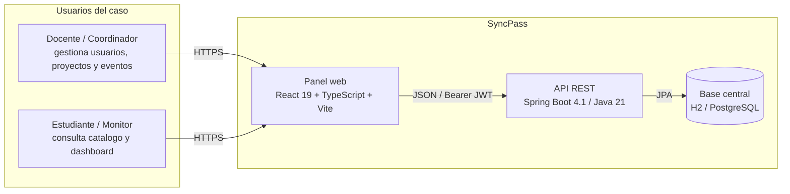
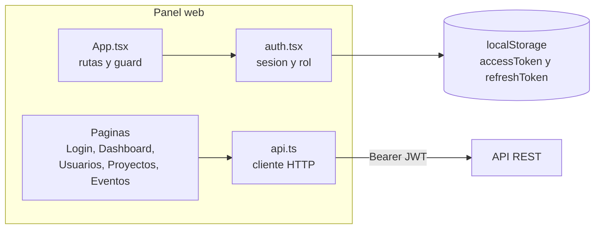

# Arquitectura — panel web

El panel es el cliente de escritorio de SyncPass: consume la API y aplica un guard de UI por rol. La autorización real vive en la API.

## Contexto (C1)

## Contenedores (C2)

## Piezas

| Archivo | Responsabilidad |
| --- | --- |
| `src/App.tsx` | Rutas con `wouter` y `Guard` que redirige sin sesión o sin rol |
| `src/auth.tsx` | `AuthProvider`, decodifica el JWT y expone `user`, `hasRole` y `login/logout` |
| `src/api.ts` | Cliente `fetch`, tipos del contrato y manejo de errores |
| `src/pages/Login.tsx` | Formulario y estados de carga/error |
| `src/pages/Dashboard.tsx` | Totales de la API |
| `src/pages/Usuarios.tsx` | Alta, baja, alta de nuevo y eliminación (Coordinador) |
| `src/pages/Proyectos.tsx` | CRUD de proyectos (escritura solo Coordinador) |
| `src/pages/Eventos.tsx` | CRUD de eventos por proyecto (escritura solo Coordinador) |
| `src/catalogo.ts` | Validaciones y conversión de formularios |

## Sesión y roles

1. `POST /api/auth/login` devuelve `accessToken`, `idToken` y `refreshToken`.
2. Los tokens se guardan en `localStorage`.
3. El rol se lee del JWT (`roles` o `cognito:groups`).
4. Cada request lleva `Authorization: Bearer`.
5. `Guard` redirige a `/login` sin sesión y a `/` si falta el rol.

El guard no es seguridad: un Monitor que llame la API recibe `403`.

## Contrato que consume

Los endpoints y el detalle de permisos están en el repo de la API:

- [Arquitectura del sistema](https://github.com/jorgeCisternasDev/syncpass-api/blob/main/docs/arquitectura.md)
- [Roles y permisos](https://github.com/jorgeCisternasDev/syncpass-api/blob/main/docs/roles-permisos.md)
- [Casos de uso](https://github.com/jorgeCisternasDev/syncpass-api/blob/main/docs/casos-de-uso.md)

Rutas y estados de la interfaz: [vistas-web.md](vistas-web.md).
