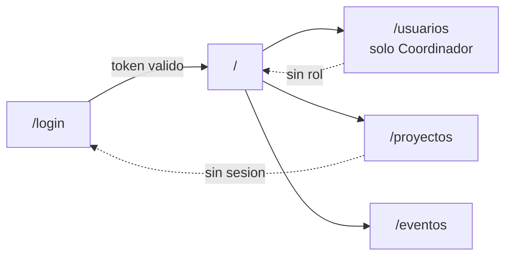

# Vistas y navegación — panel web

## Rutas

| Ruta | Acceso | Datos | Estados visibles |
| --- | --- | --- | --- |
| `/login` | Público | `POST /api/auth/login` | Carga con botón deshabilitado; error; credenciales inválidas |
| `/` | Sesión | `GET /api/dashboard/resumen` | Carga (`…`), error silencioso, totales |
| `/usuarios` | Coordinador | `GET /api/usuarios` | Carga, error, lista, alta, feedback |
| `/proyectos` | Sesión | `GET /api/proyectos` | Carga, error, vacío, formulario y acciones por rol |
| `/eventos` | Sesión | `GET /api/proyectos` + `GET /api/proyectos/{id}/eventos` | Sin proyectos, lista, formulario y acciones |

## Navegación

- Sin sesión, cualquier ruta redirige a `/login`.
- Con sesión, `/usuarios` redirige a `/` si el rol no es Coordinador.
- El menú (`Nav`) muestra Usuarios solo al Coordinador.
- Logout limpia los tokens y vuelve al login.

## Comportamiento por pantalla

- **Login:** muestra el mensaje del servidor y no guarda token si falla.
- **Dashboard:** si el resumen falla, deja los totales en guion y conserva la sesión.
- **Usuarios:** Coordinador ve alta, baja, alta de nuevo y eliminación; Monitor ve solo la lista y un aviso.
- **Proyectos:** formulario para crear o editar; lista vacía con texto guía; Monitor sin botones de escritura.
- **Eventos:** sin proyectos indica crear uno primero; el evento se edita en el mismo formulario.

## Límites

- No administra asistencias ni encuestas: eso vive en la app.
- No hay vista de participantes.
- El guard es de interfaz; la API es la que autoriza.

Para la demo: [demo-web.md](demo-web.md). Para pruebas: [pruebas-web.md](pruebas-web.md).
